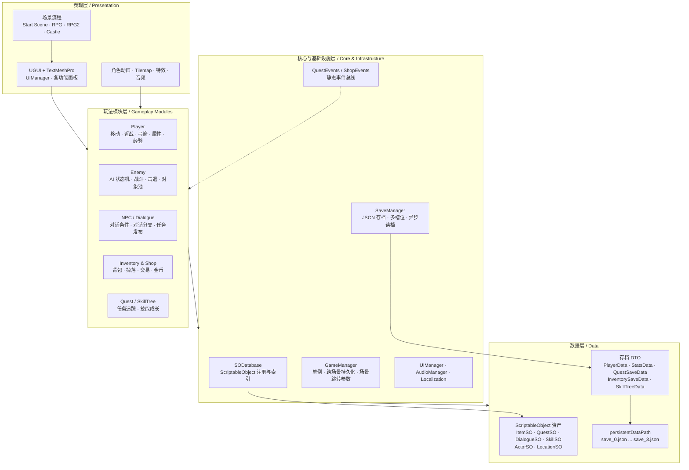
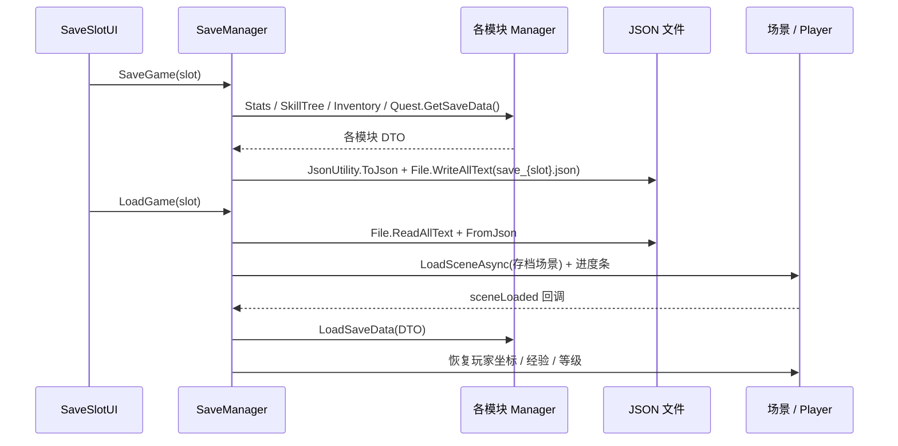

# 像素风 2D ARPG Demo


一个使用 **Unity 2022.3 LTS + C#** 独立开发的 2D 像素风动作 RPG 原型。项目完成了从**主菜单 → 探索 → 战斗 → 对话 → 任务 → 背包/商店 → 技能树 → 存档**的完整玩法闭环，并按照业务域对代码进行分层与模块化组织。

项目重点不在于堆叠美术资源，而在于展示一套可扩展的游戏系统架构：**数据驱动（ScriptableObject）、事件解耦、跨场景持久化、统一存档管线、对象池与状态机**。

> 代码规模：约 75 个业务 C# 脚本、4,300+ 行代码（不含 TextMesh Pro 示例代码）；4 个可运行场景。

---

## 目录

- [项目亮点](#项目亮点)
- [功能概览](#功能概览)
- [核心技术栈](#核心技术栈)
- [架构设计](#架构设计)
- [模块职责](#模块职责)
- [关键机制](#关键机制)
- [目录结构](#目录结构)
- [快速开始](#快速开始)
- [已知限制与优化方向](#已知限制与优化方向)
- [第三方资源](#第三方资源)

---

## 项目亮点

- **分层 + 按业务域拆分的模块化架构**：`Core` / `Modules` / `SaveSystem` 三层划分，玩法模块之间通过事件与统一数据源通信，避免交叉引用。
- **数据驱动设计**：`ItemSO`、`QuestSO`、`DialogueSO`、`SkillSO`、`ActorSO`、`LocationSO` 全部基于 ScriptableObject，策划数据与逻辑代码分离。
- **统一数据注册中心 `SODatabase`**：启动时构建字典索引，为背包、任务、对话提供按名称的 O(1) 查询，同时解决存档只序列化名称、不序列化对象引用的问题。
- **事件驱动解耦**：通过 `QuestEvents`、`ShopEvents` 以及 `C# event/delegate`，让经验、掉落、技能、任务、商店等系统互不直接依赖。
- **完整的存档方案**：`SaveData` 聚合各模块存档 DTO，`JsonUtility + persistentDataPath` 落盘，支持 4 个槽位、时间戳、删除、异步读档进度条，并在 `sceneLoaded` 后恢复运行时状态。
- **对象池与状态机**：使用 `UnityEngine.Pool.ObjectPool` 管理敌人与掉落物；NPC、敌人使用有限状态机组织行为。

---

## 功能概览

| 模块 | 已实现内容 |
| --- | --- |
| 场景流程 | 主菜单、新游戏、读档、设置、退出；`Start Scene → RPG / RPG2 / Castle` 多场景切换 |
| 角色控制 | 八方向移动、动画混合、翻转、击退与受击硬直 |
| 战斗系统 | 近战挥砍（扇形/圆形检测）、弓箭远程射击、飞行物弹道与障碍物吸附、冷却控制 |
| 敌人 AI | 感知玩家、追击、进入攻击距离后攻击、受击击退，状态机驱动 |
| 属性与成长 | 生命、魔法、攻防、速度、闪避、幸运等 11 项属性；经验、升级、技能点 |
| 技能树 | 4 阶 × 5 级升级、前置技能解锁、加点消耗、属性加成、技能存档 |
| NPC 与对话 | Idle / Patrol / Wander / Talk 状态；多分支选项、条件对话、对话历史记录 |
| 任务系统 | 任务接取、目标进度追踪、道具/地点/NPC 三类目标、提交道具、发放奖励、任务日志 UI |
| 背包与掉落 | 格子背包、堆叠上限、使用/丢弃物品、世界掉落物拾取、加权随机掉落表 |
| 商店 | 商品列表、分页签（道具/武器/护甲）、购买、出售、金币结算 |
| 存档系统 | 4 槽位、保存/读取/删除、时间戳、异步加载进度条、跨场景状态恢复 |
| UI 与交互 | 主菜单、状态面板、技能树、任务面板、背包、商店、对话、设置、存档面板；Esc 统一关闭 |
| 摄像机与场景 | Cinemachine 跟随、场景切换后自动查找边界 Confiner、白屏淡入淡出 |
| 音频与本地化 | BGM/音效音量设置并写入 `PlayerPrefs`；Unity Localization 中英文本地化 |

---

## 核心技术栈

| 类别 | 技术 | 说明 |
| --- | --- | --- |
| 引擎 / 语言 | Unity 2022.3.62f3c1 LTS、C# | 2D URP 项目模板 |
| 渲染 / 表现 | Sprite、Tilemap、Animator、Particle System | 像素风场景、角色动画与特效 |
| UI | UGUI、TextMeshPro 3.0.7 | CanvasGroup 驱动的面板显隐与交互控制 |
| 摄像机 | Cinemachine 2.10.7 | 跟随、边界限制、场景切换自适应 |
| 物理 | Physics2D、LayerMask、OverlapCircleAll、Collision2D | 战斗判定、敌人感知、掉落拾取 |
| 数据驱动 | ScriptableObject | 物品、任务、对话、技能、NPC、地点数据资产 |
| 架构模式 | 单例、事件总线、有限状态机、对象池、DTO | 模块解耦与运行时状态管理 |
| 存储 | `JsonUtility` + `Application.persistentDataPath` + `File IO` | 多槽位 JSON 存档 |
| 异步加载 | `SceneManager.LoadSceneAsync` + Coroutine | 读档进度条与场景切换 |
| 本地化 | Unity Localization 1.5.3 + Addressables 1.22.3 | 中文（zh-Hans）/ 英文（en）字符串表 |
| 开发工具 | Visual Studio / Rider、Unity Test Framework | 工程组织与后续测试扩展 |

---

## 架构设计

### 总体分层



### 架构原则

1. **表现与逻辑分离**：UI 只负责展示与转发输入，核心状态由 Manager 持有；场景中通过 CanvasGroup 控制面板状态。
2. **运行状态与静态数据分离**：物品/任务/对话等静态配置放在 ScriptableObject，运行时状态放在 Manager 与存档 DTO 中。
3. **模块之间尽量单向依赖**：玩法模块可依赖基础设施层，基础设施层不反向依赖具体玩法；广播型需求通过事件完成。
4. **存档按模块自治**：每个 Manager 自己实现 `GetSaveData()` / `LoadSaveData()`，`SaveManager` 只负责聚合、序列化与调度，新增模块无需修改序列化细节。

---

## 模块职责

| 模块 | 关键脚本 | 职责 |
| --- | --- | --- |
| 核心 | `GameManager`、`SwitchLanguage` | 全局单例、跨场景持久化对象注册、场景跳转参数、语言切换 |
| UI | `UIManager`、`LoadCanvas`、`CursorCtrl` | 面板状态机、暂停/恢复 `Time.timeScale`、自定义光标与点击音效 |
| 玩家 | `PlayerMovement`、`Player_Combat`、`Player_Bow`、`PlayerHealth`、`ExpManager` | 移动、近战、远程、生命同步、经验与升级 |
| 属性 | `StatsManager`、`StatsData`、`StatsUI` | 11 项属性读写、事件通知（血量/名称）、存档与 UI 刷新 |
| 敌人 | `EnemyPool`、`Enemy_Movement`、`EnemyHealth`、`Enemy_combat`、`Enemy_Knockback` | 定时生成、感知/追击/攻击/击退状态、死亡回收、经验广播 |
| NPC / 对话 | `NPC`、`NPC_Patrol`、`NPC_Wander`、`NPC_Talk`、`DialogueManager`、`DialogueSO` | NPC 状态机、条件对话、分支选项、对话历史 |
| 任务 | `QuestManager`、`QuestSO`、`QuestEvents`、`QuestLogUI`、`QuestBoard` | 接取/完成、目标进度、奖励结算、任务日志与任务板 |
| 背包 / 商店 | `InventoryManager`、`ItemSO`、`Loot`、`LootPool`、`ShopManager`、`ShopUI` | 物品堆叠与使用、掉落池、商店买卖、金币 |
| 技能树 | `SkillTreeManager`、`SkillSlot`、`SkillSO`、`SkilManager` | 加点、前置解锁、等级上限、属性加成、技能存档 |
| 存档 | `SaveManager`、`SaveData`、`SaveSlotUI`、`SODataBase` | 多槽位保存/读取/删除、异步场景加载、数据资产索引 |
| 音频 | `AudioManager` | BGM/音效音量、PlayerPrefs 持久化 |
| 场景 / 摄像机 | `SceneChange`、`ConfinerFinder`、`PlayerPosition` | 传送与淡入淡出、Confiner 自动绑定、出生点恢复 |

---

## 关键机制

### 1. 跨场景持久化

`GameManager` 作为全局根节点使用 `DontDestroyOnLoad` 常驻，并提供 `RegisterPersistentObject()` 让背包、属性、技能、商店等 Manager 动态注册为持久对象。切换场景时：

- 传送门通过 `SetPlayerStartPosition()` 写入目标出生点；
- 新场景中的 `PlayerPosition` 在 `Start()` 中读取并落位；
- `UIManager`、`SaveManager` 监听 `SceneManager.sceneLoaded` 完成面板与存档状态的切换。

### 2. 数据驱动与 SODatabase

所有静态配置均为 ScriptableObject，运行时不依赖硬编码表。`SODatabase` 在 `Awake()` 中把资产加入以名称为键的字典：

```csharp
private Dictionary<string, ItemSO> itemCache = new Dictionary<string, ItemSO>();

public ItemSO GetItem(string name)
{
    itemCache.TryGetValue(name, out ItemSO itemSO);
    return itemSO;
}
```

这样存档只需保存 `itemSO.name`、`questName` 等稳定标识；读档时通过 `SODatabase` 反查资产，避免直接序列化 Unity 对象引用。

### 3. 事件驱动解耦

模块之间通过静态事件与 C# 委托通信，典型链路：

```text
击杀敌人
  └─ EnemyHealth.OnMonsterDefeated
       └─ ExpManager.GainExperience
            └─ 满经验 → ExpManager.OnLevelUp
                 └─ SkillTreeManager 增加可用技能点
```

```text
拾取掉落物
  └─ Loot.OnItemLooted
       └─ InventoryManager.AddItem
            ├─ 可堆叠 → 合并到已有格子
            ├─ 空格子 → 放入新格子
            └─ 背包已满 → 重新生成世界掉落物
```

### 4. 存档管线



存档内容按模块拆分为 `PlayerData`、`StatsData`、`SkillTreeData`、`QuestSaveData`、`InventorySaveData`，由 `SaveData` 聚合。任务与物品的进度以名称/索引形式持久化，读档时再映射回 ScriptableObject 资产。

### 5. 状态机与对象池

- **NPC 状态机**：`Idle / Patrol / Wander / Talk`，玩家进入触发器后切换 Talk 并锁定移动。
- **敌人状态机**：`Idle / Chasing / Attacking / Knockback`，由 `Enemy_Movement` 统一切换动画与速度。
- **对象池**：`EnemyPool` 与 `LootPool` 基于 `ObjectPool<GameObject>`，预分配容量、限制场景内最大数量，并在动画结束后回收，避免频繁 Instantiate/Destroy 造成 GC 峰值。

### 6. 本地化

使用 Unity Localization 管理 `UI` 字符串表，提供中文（zh-Hans）与英文（en）两个 Locale；`SwitchLanguage` 通过 `LocalizationSettings.SelectedLocale` 在运行时切换，字符串表资源由 Addressables 组织。

---

## 目录结构

```text
Assets/
├─ Core/                    # GameManager、语言切换等全局入口
├─ Modules/
│  ├─ Player/               # 玩家移动、战斗、属性、经验、UI
│  ├─ Enemy/                # 敌人 AI、生命、战斗、击退、对象池
│  ├─ NPC/                  # NPC 状态机、对话、ActorSO、LocationSO
│  ├─ Quest/                # 任务数据、管理器、日志与任务板
│  ├─ Inventory & Shop/     # 背包、掉落、物品、商店
│  ├─ SkillTree/            # 技能树、技能节点、加点与属性加成
│  ├─ UI/                   # UIManager、光标、加载面板
│  ├─ Scene/                # 场景传送
│  ├─ CameraScripts/        # Cinemachine Confiner 自适应
│  ├─ Audio/                # 音频与音量设置
│  ├─ StartMenu/            # 主菜单流程
│  ├─ LocaleSetting/        # Localization 配置与字符串表
│  └─ Tilemap/              # 高地层级切换
├─ SaveSystem/              # SaveManager、SaveData、SODatabase、存档 UI
├─ Prefabs/                 # 持久化对象、UI、掉落物等预制体
├─ Scenes/                  # Start Scene / RPG / RPG2 / Castle
├─ Sprites/、Fonts/、Materials/ 等 # 美术与字体资源
Packages/                   # Unity Package 依赖
ProjectSettings/            # 工程与输入配置
```

---

## 快速开始

### 环境要求

- Unity Hub + **Unity 2022.3.62f3c1（LTS）**
- 推荐使用 Visual Studio 2022 或 JetBrains Rider
- 首次打开会自动拉取 `Packages/manifest.json` 中的依赖

### 运行步骤

1. 使用 Unity Hub 添加本项目根目录（包含 `Assets`、`Packages`、`ProjectSettings` 的目录）。
2. 使用 Unity 2022.3.62f3c1 打开工程，等待资源导入与脚本编译完成。
3. 打开 `Assets/Scenes/Start Scene.unity`，点击 Play。
4. 点击「新游戏」进入 `RPG` 场景；Build Settings 中已按 `Start Scene → RPG → RPG2 → Castle` 顺序配置。

### 操作说明

| 操作 | 按键 |
| --- | --- |
| 移动 | `W / A / S / D` 或方向键 |
| 近战攻击 | `K` |
| 弓箭射击 | `J` |
| 切换近战 / 弓箭 | `Q` |
| 交互（对话、商店、任务板） | `F` |
| 打开属性面板 | `1` |
| 打开技能树 | `2` |
| 关闭当前面板 / 退出商店 | `Esc` |
| 使用物品 / 出售物品 | 鼠标左键 |
| 丢弃物品 | 鼠标右键 |

---

## 已知限制与优化方向

项目当前作为个人原型，还保留了一些可以继续工程化的点：

1. **移除 Runtime 脚本中的 Editor 命名空间**：部分脚本误引入了 `UnityEditor` 相关命名空间，需要清理后才能稳定打包 Player。
2. **输入系统升级**：目前使用旧版 Input Manager，可迁移到 Unity Input System，获得更清晰的输入映射与多设备支持。
3. **存档健壮性**：可增加存档版本号、字段校验、原子写入（临时文件 + 替换）与异常捕获，避免写盘中断导致存档损坏。
4. **依赖注入替代单例**：将 Manager 之间的 `Instance` 直接访问逐步替换为接口注入或服务定位器，降低模块耦合，便于单元测试。
5. **Assembly Definition 拆分**：按 `Core` / `Modules` / `SaveSystem` 划分程序集，缩短编译时间并强制约束依赖方向。
6. **自动化测试与 CI**：项目已引入 Unity Test Framework，后续可为背包堆叠、任务进度、属性计算、存档序列化补充 EditMode / PlayMode 测试。
7. **内容扩展**：将敌人掉落表、商店商品、技能效果进一步数据化，并接入正式的资源加载与内容更新流程。

---

## 第三方资源

- **像素美术**：Tiny Swords 像素素材包（第三方免费素材）
- **字体**：霞鹜文楷 / LXGW XiHei（开源字体）
- **UI 与文本**：TextMesh Pro
- **音频、图标等**：用于个人学习与作品展示

---

## 作者

- 姓名：`<待填写>`
- 邮箱 / 微信：`<待填写>`
- 求职方向：Unity 客户端开发 / 游戏开发实习生

如果这个项目对你有帮助，欢迎在 Issues 中交流。

<!--
建议补充 3-4 张项目截图（主菜单、战斗、任务、商店、技能树）后取消注释：


-->
